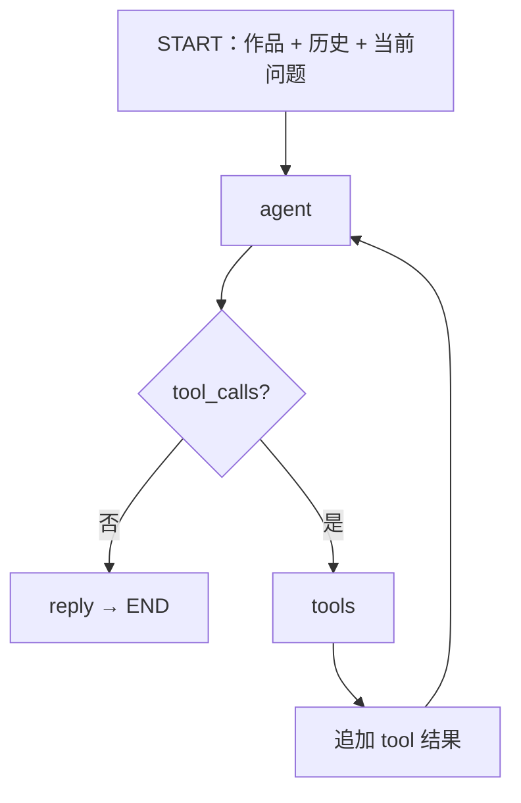

# Poeticus：LangGraph Agent 架构

## 1. 当前模型

Poeticus 的聊天工作流定义在 `backend/ai/graph.py`，`langgraph.json` 直接指向 `backend/ai/graph.py:graph`。

当前使用 ReAct 式循环：模型根据当前作品、作品元数据、用户选区、近期对话和问题，决定直接回答或调用外部工具。系统不再使用固定 Intent Router。



## 2. Agent

首次进入 `agent` 时，系统组合：

1. system prompt；
2. 前端携带、后端已经校验的 bounded history；
3. 当前作品上下文、选区和问题。

之后的 Agent 轮次沿用本次请求的 `messages`，其中包含工具调用与工具返回。

模型、输出 Token 预算和工具调用预算都来自后端统一配置。当前单次用户请求最多执行 **2 次实际工具调用**；达到预算后不再允许新的真实工具执行。

## 3. 工具与 Evidence

当前 Agent 以四种基础/原有工具为起点，另有三组**默认关闭、仅本地研究用**的工具集；实际可见项由本轮服务配置决定：

- `lookup_allusion`：人物故事、掌故、神话与典故性短语；
- `lookup_reference`：外部 reference evidence；
- `search_predecessor_texts`：Poeticus 自建 Corpus 的前代文本候选检索；
- `search_documents`：本地 Document Corpus 的历代词话与评论候选检索（开发实验）。
- CNKGraph 研究组（5 项）：`analyze_ci_meter`、`search_classical_books`、`lookup_ci_tune`、`lookup_rhyme`、`resolve_entities`。服务条款限定个人非商业研究，不能默认给公开 Railway 用户使用。
- DeepSeek 联网组（2 项）：`web_search`、`web_fetch`；独立计费，`web_fetch` 只能读取本轮已搜索返回的 URL，默认关闭。
- 字词/原文组（3 项）：`lookup_moedict`、`search_wikisource`、`read_wikisource_page`；保留辞典/维基文库的来源与授权语义，默认关闭。

`backend/ai/tools.py` 定义模型可见的 Schema；`available_tools(...)` 按五种独立开关组合工具：Poem Retrieval、Document Corpus、CNKGraph Research、DeepSeek Web、Classic References。图节点在执行前重新核对**本轮实际注册工具名单**，未启用的工具不能因为模型自行说出名字就绕过开关。配置启用不等于对应服务健康、许可通过或线上已经启用。设置及权限边界见 [开发者指南](../development.md)。

工具调用由 `backend/ai/graph.py` 的 `execute_tools()` 执行：典故与出处查询通过 `EvidenceService.search()` 交给 CNKGraph Provider；诗词互文检索通过 `TextRetrievalClient` 请求独立 Poem Retrieval Service；文献评论检索通过本机 `DocumentRetrieval` 查询 PostgreSQL + BM25/pgvector；三个研究工具组通过各自只读 HTTP Adapter 执行，并使用独立的权限、预算与来源限制。文献工具使用用户原始问题，并允许模型补充最多两条查询；返回的是带来源锚点的**候选证据**，不等于校勘或事实认证。

对外 `backend/mcp/server.py` 也通过 `EvidenceService` 查询典故与出处，但它是独立的 MCP 入口；现有 Agent 不经过 MCP Server。`EvidenceService` 负责选择 Provider 并返回 `EvidenceItem`，Agent 与 MCP 分别整理自己的输出格式。

用户明确追问“借了谁哪一句 / 化用了哪段前代文本”时，Agent 优先使用 `search_predecessor_texts`。第一轮结果弱时，可以在当前 2 次工具预算内换一个更有辨识度的文本锚点继续检索。

工具返回可以是：

- `ok`
- `no_hit`
- `error`
- `budget_exceeded`

候选资料只是回答材料，不自动等于已经完成文献校勘。外部文本进入后续模型调用前会做长度限制。

Poem Retrieval 返回的 chronology status 也只是粗粒度信号。Werneror 的 dynasty label 会把部分五代人物标成“唐”；Agent 不能把它直接表述成精确历史断代。

当前已验证的产品路径：

```text
textual provenance question
→ search_predecessor_texts
→ first corpus result
→ 必要时 query reformulation
→ second corpus retrieval
→ candidate evidence
→ final answer
```

陆游“片片轻鸥落晚沙”已经完成真实线上 E2E：Retriever 在 `dynasty=null` 的请求下召回杜甫“片片轻鸥下急湍”，Agent 最终采用该证据，并保留“文本对应很强 / 缺少明确引用记载”的不确定性边界。

## 4. Graph State

`AgentState` 是整个 LangGraph 工作流的共享状态；各节点使用 `AgentStateUpdate` 返回本节点更新的字段。两种类型都定义在 `backend/ai/graph.py`，没有改变状态字段或节点拓扑。

`AgentState` 的主要字段：

| 字段 | 用途 |
| --- | --- |
| `poem` / `question` | 当前原文和问题 |
| `selection` / `context` | 可选选区与作品元数据 |
| `history` | 此轮之前的短期 user / assistant 历史 |
| `messages` | 当前一次 Agent 执行内部消息 |
| `tool_calls` / `tool_results` | 当前工具请求与最近结果 |
| `tool_count` | 已执行工具数量 |
| `evidences` | 累计候选证据 |
| `reply` | 最终回答 |
| `stream_reply` | 是否使用流式模型调用 |

`history` 与 `messages` 不是同一层：前者跨用户轮次，由客户端携带；后者只服务当前这一次 Graph 执行。

## 5. HTTP 与流式输出

公开聊天入口：

- `POST /api/chat` → `graph.invoke()`
- `POST /api/chat/stream` → `graph.stream()`

开发代理兼容的无 `/api` 路径仍由 FastAPI 路由支持，但项目内部 Python 模块不再保留根目录兼容入口。

流式模式使用 LangGraph `custom` 事件传正文 token，用 `updates` 获取节点结果。FastAPI 转为 SSE：

- `token`
- `done`
- `error`

如果模型在工具调用前先输出说明文字，这部分可能先显示；工具完成后的正式回答以新的 token 段继续输出。API 会校验最终正式回答与 Graph 的 `reply` 一致。

## 6. 会话边界

浏览器可以保存比模型实际看到的更多历史。发送请求时，前端从 `/api/capabilities` 获取后端声明的最大历史轮数，再只发送最近已完成 Turn；后端仍做最终校验。

服务端目前没有长期 Conversation persistence、跨设备同步或可恢复 Run。详情见 [conversation-state.md](conversation-state.md)。
