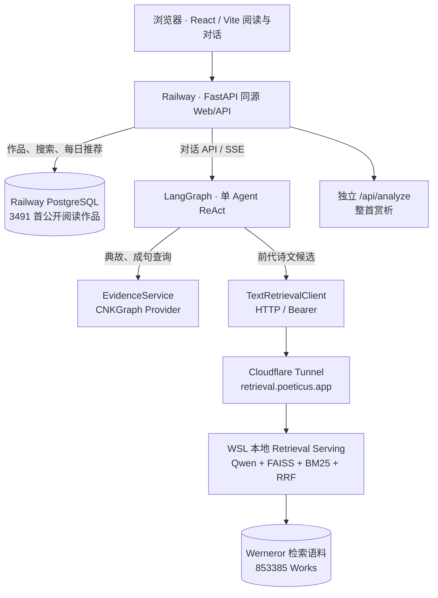
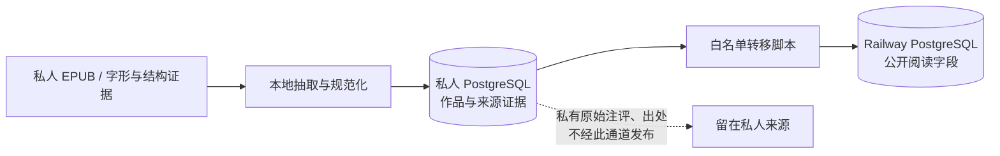

# Poeticus 架构盘点｜2026-10-18 第一轮

> 状态：**只读调查快照 / Draft**，不是现行架构的新权威文档，也不是远期技术选型决定。
> 负责追踪：[Issue #336](https://github.com/montricwang/poeticus/issues/336)。
> 范围：第一轮只恢复 main 的运行边界、现有设计与研究状态，后续再补测试/PR 证据、全部开放 Issue 分类及目标架构。**不要将本报告中提及的候选能力解释为已实现。**

## 1. 为什么做、证据怎么看

截至这一轮，项目已有阅读器、Agent、Poem Retrieval、数据发布链、部署架构与大量专项研究；缺少跨领域的统一视图。本文的任务是把「代码实际存在」「曾经运行验证」「可以施工」「尚待论证」分开。

证据强度按以下顺序记录，不互相替代：

1. **源代码 / 数据契约**：main 中真实存在入口与调用；不保证运行环境可用。
2. **自动测试**：有测试文件和可执行路径；本轮只读访问 GitHub，**未在本地运行测试**。
3. **已记录的真实 E2E**：以部署文档、PR / Issue 中的具体日期为准；不是此刻实时健康检查。
4. **研究提案 / Issue**：记录意图和假设，不能标为生产能力。

本轮 GitHub 主分支及文档已检查；Poeticus Serena 连接不可用，尚未进行本地运行/动态追踪。因此这是一张有明确边界的**静态证据图**。

## 2. 当前系统：As-Is

这里区分**两套 Corpus**：

- **公开阅读库**：来源于私有 EPUB 数据处理与白名单发布，Railway PostgreSQL 为阅读 API 提供 3491 首作品。
- **Poem Retrieval Corpus**：Werneror 853385 Work，服务于前代文本候选召回；Work ID 与阅读库 UUID 不属于同一身份系统。

核心代码可追溯：

- [FastAPI 应用组装](https://github.com/montricwang/poeticus/blob/main/backend/app.py)；[对话接口](https://github.com/montricwang/poeticus/blob/main/backend/api/chat.py)；[独立赏析接口](https://github.com/montricwang/poeticus/blob/main/backend/api/analysis.py)。
- [Agent ReAct 状态与工具执行](https://github.com/montricwang/poeticus/blob/main/backend/ai/graph.py)；[三类候选读工具](https://github.com/montricwang/poeticus/blob/main/backend/ai/tools.py)。
- [EvidenceService](https://github.com/montricwang/poeticus/blob/main/backend/evidence/service.py)；[检索 HTTP Client](https://github.com/montricwang/poeticus/blob/main/backend/retrieval/poem/client.py)。
- [作品数据链](https://github.com/montricwang/poeticus/blob/main/docs/architecture/corpus-database.md)；[部署拓扑与 10 月 14 日 E2E](https://github.com/montricwang/poeticus/blob/main/docs/deployment.md)。

### 数据生产与公开边界

这条数据隔离是 [ADR-0004](https://github.com/montricwang/poeticus/blob/main/docs/adr/0004-private-public-corpus-boundary.md) 已确认的架构原则；未来评论、注释与 Benchmark 涉及出版社整理本时，需重新核对来源权利，不能将私有材料直接纳入公网站点或仓库。

## 3. 能力成熟度：第一轮分类

| 能力 | 本轮状态 | 直接依据 / 需要补查 |
| --- | --- | --- |
| 响应式阅读、目录、每日推荐、划词伴读 | **已有代码** | [README](https://github.com/montricwang/poeticus/blob/main/README.md)、[作品 API](https://github.com/montricwang/poeticus/blob/main/docs/architecture/corpus-database.md)；设备端回归仍需区分 |
| 作品库 / 私有→公开发布 | **已有代码、已文档化运行** | Corpus Database、ADR-0004；逐首校勘未完成 |
| ReAct 对话 + 有界历史 + SSE | **已有代码** | graph.py、api/chat.py；[会话状态](https://github.com/montricwang/poeticus/blob/main/docs/architecture/conversation-state.md) |
| CNKGraph 典故与成句查询 | **已有代码** | EvidenceService / Provider；不能推断其整个人物知识图谱已接入 |
| Poem Retrieval / HTTP Serving | **已有代码，历史 E2E 已记录** | [Retrieval 架构](https://github.com/montricwang/poeticus/blob/main/docs/architecture/text-retrieval.md)、[部署记录](https://github.com/montricwang/poeticus/blob/main/docs/deployment.md)；当前 WSL/Tunnel 在线情况未测 |
| 整首实时赏析 | **已有独立模型调用** | api/analysis.py；并不自动使用 Agent 工具 |
| 文献 Document Corpus / 古籍 RAG | **已规划，需最小实验** | [#133](https://github.com/montricwang/poeticus/issues/133)、[#237](https://github.com/montricwang/poeticus/issues/237) |
| 本地注释/词条义项库及离线批注 | **新设计，未实施** | [#335](https://github.com/montricwang/poeticus/issues/335) |
| 文学知识关系 / 专门图数据库 | **研究阶段，暂不选库** | [#149](https://github.com/montricwang/poeticus/issues/149)；PostgreSQL 小型关系表是待验证候选 |
| 产品端外部 MCP/API 扩展 | **试验/候选，不等于产品 Agent 已接** | [#233](https://github.com/montricwang/poeticus/issues/233)、[#238](https://github.com/montricwang/poeticus/issues/238) |
| Critic Persona + Style Skill | **近期可进入最小施工/评测** | [#148](https://github.com/montricwang/poeticus/issues/148)、[P0 #311](https://github.com/montricwang/poeticus/issues/311)；原则草案不等于已达到独立审美能力 |
| Critic Notebook / 自主研究与人格演化 | **远期研究，未上线** | [#311–#314](https://github.com/montricwang/poeticus/issues/311)、[研究提案](https://github.com/montricwang/poeticus/blob/main/docs/research/critic-self-evolution.md) |
| 文学推荐与作品画像 | **研究，有负面实验结论** | [文学学习研究规划](https://github.com/montricwang/poeticus/blob/main/docs/literary-learning-research-plan.md)、[#156](https://github.com/montricwang/poeticus/issues/156) |

**提示**：「可施工」表示近期目标已清楚，仍需按对应 Issue 核对最小变更、Baseline 和验收，不能仅凭此表提交业务 PR。

## 4. 已能确认的跨域约束

- **作品身份与文献来源优先于索引细节**：阅读作品 UUID、检索 Work ID、外部文献卷则/版本和原文锚点不可混为同一 ID。相关 [Corpus Database](https://github.com/montricwang/poeticus/blob/main/docs/architecture/corpus-database.md)、[#133](https://github.com/montricwang/poeticus/issues/133)。
- **候选证据与文学断言分开**：相似句 ≠ 化用成立；书目或关系字段 ≠ 已核验史实。见 [ADR-0002](https://github.com/montricwang/poeticus/blob/main/docs/adr/0002-hybrid-text-retrieval.md)、[#149](https://github.com/montricwang/poeticus/issues/149)。
- **外部工具不拥有文学判断权**：API/MCP 与本地检索都是证据入口。Agent 调度和解释，不因增加工具而预先重写 ReAct。见 [#154](https://github.com/montricwang/poeticus/issues/154)。
- **共享 Critic Notebook 与读者私有记忆隔离**：原典/论文属于 Library，Critic 的研究结论属于可审查的 Notebook，用户个人聊天记忆另有所有权。见 [#148](https://github.com/montricwang/poeticus/issues/148)、[#45](https://github.com/montricwang/poeticus/issues/45)。

## 5. 已发现的文档差异与待核事项

| 项目 | 当前观察 | 建议 |
| --- | --- | --- |
| Roadmap 版本状态 | [GitHub v0.6.0 Release](https://github.com/montricwang/poeticus/releases/tag/v0.6.0) 已发布，但 [Roadmap](https://github.com/montricwang/poeticus/blob/main/docs/roadmap.md) 仍写 v0.5.0 与 v0.6.0 准备中 | 单独、最小地修正状态，核对 v0.6.0 实际范围 |
| #119 与 Roadmap 的 Reranker | [#119](https://github.com/montricwang/poeticus/issues/119) 为**离线实验**；Roadmap 停止线指不惯性纳入当前**生产主线** | 分类时注明两者并不互相否定，不急着改算法 |
| 既有 Agent Map 与产品整体 | [Agent Capability Map](https://github.com/montricwang/poeticus/blob/main/docs/architecture/agent-capability-map.md) 是 AI 证据子图，非全平台地图 | 总览要覆盖阅读、用户状态、离线数据等，不改写原 Map 细节 |
| 研究方向分散 | [文学学习研究规划](https://github.com/montricwang/poeticus/blob/main/docs/literary-learning-research-plan.md) 与 [Critic 研究提案](https://github.com/montricwang/poeticus/blob/main/docs/research/critic-self-evolution.md) 有交叉；#311 后来明确短期 P0 | 恢复各自目标和最新优先级；不直接删文件或合并研究结论 |
| 完整 Issue 治理 | 本轮 GitHub 查询当前约 79 条开放 Issue，已有不少历史关闭记录 | 下一阶段按**领域归并 / 状态证据**，禁止批量复述、改写或关闭 |

## 6. 下一轮验证入口与停止线

继续 [#336](https://github.com/montricwang/poeticus/issues/336) 的 B/C 阶段，优先只做三件事：

1. **Issue 分组和归属**：阅读/体验、Corpus/版权、Evidence/Retrieval、Critic/研究、用户状态/平台、部署工程；每组只保留一个权威入口，记录其它任务的关系和状态。
2. **决策依赖表**：先查作品与文献身份、来源/版本、私有/公开知识状态这类硬依赖；再查向量库、Neo4j、MCP 协议、Agent 规划等可推迟选型。
3. **目标架构草图 + Gap**：只建立职责边界，逐项标明已实现、可以施工、需限时实验、远期未知。Roadmap 只跟进有依据的最近里程碑。

本轮**不改生产代码、不开新服务、不冻结远期数据 Schema、不排全部 Issue 的日程、不宣称已完成现场 E2E**。本报告是一次性调查快照；审定后的长期架构事实应回到现有架构文档和 ADR，避免产生第二套权威事实。
