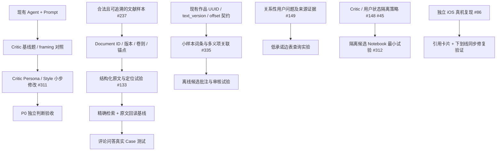

# Poeticus：责任领域、决策依赖与近期交付切片

> **调查日期**：2026-10-18。**状态**：#336 的 B/C 阶段设计草案，非冻结的远期架构或正式排期。
> **证据基线**：主线 v0.6.0；当前运行结构另见 [第一轮 As-Is 盘点（Draft PR #337）](https://github.com/montricwang/poeticus/pull/337)。
> **用途**：用真实前置条件组织工作，避免 Roadmap、Backlog、领域架构、Research Proposal 变成彼此竞争的计划。本文件是一次性方案审查；审定后长期事实应归回各权威领域文档，不持续维护第二套完整 Backlog。

## 1. 企业规划方法在 Poeticus 中怎样使用

从需求到施工至少区分五种不同对象：

| 对象 | 问什么 | 唯一权威位置 |
| --- | --- | --- |
| 产品目标 / Outcome | 读者最终获得什么能力、为什么值得做 | [README](../../README.md)；[Roadmap](../roadmap.md) 给阶段里程碑 |
| 能力与模块边界 | 哪个领域负责产生、保存或解释什么信息 | [现有架构](../architecture/)；必要时 ADR |
| 决策与依赖 | 哪些假设已确认，前置工作不完成会造成什么实际失败 | 本次 #336 调查；定案后进入领域架构/ADR |
| 可交付工作包 / Issue | 修改/实验什么、如何验收、谁来接手 | 相应 GitHub Issue；已合并 PR 和测试作为完成证据 |
| 迭代安排 | 在有限时间/成本内先做什么 | Roadmap 近期里程碑；只为已可估计的施工包定迭代 |

**先画“任务与验证”的依赖 DAG，不把运行时模块调用图当任务 DAG。** 项目管理中的真正关键路径还需要工期和资源估计，本轮只有前置关系，不能凭箭头就宣布哪条是关键路径。

边类型分为：

- **硬依赖**：不先满足，后项无法保证正确性、可引用性或合法公开。必须写出可证伪的失败场景。
- **软依赖**：共同约定最小契约即可平行推进，例如两条独立检索业务可共享出处规范，不必使用相同索引实现。
- **决策/验收闸门**：只有实验结果达到标准才批准扩大施工；“先验收再扩大”是管理顺序，不一定是运行时技术依赖。
- **相关而非依赖**：Issue 互相链接，但没有先后限制；不用 GitHub Dependency 假装互相阻塞。

## 2. 责任领域与交接契约

“Owner”表示**哪类变更应由哪个领域承担**；Poeticus 当前是个人项目，这些是虚拟团队岗位/责任视角，**不是六支实际团队，也不预设六个微服务**。

| 工作流（对应企业的责任分工） | 负责什么、对外承诺什么 | 当前事实与入口 | 不负责什么 |
| --- | --- | --- | --- |
| **阅读体验 / Frontend** | 作品展示、选区、目录、动效、前端会话交互；按 API 的作品身份和字符偏移使用数据 | `frontend/src/App.tsx`、`frontend/src/components/`、[iOS #86](https://github.com/montricwang/poeticus/issues/86) | 编纂词典义项、裁决历史文献真实性 |
| **作品与文献数据 / Corpus** | 阅读作品的稳定身份/文本版本/来源、私有数据处理与公有发布；未来文献卷则与原文定位 | [Corpus Database](../architecture/corpus-database.md)、[ADR-0004](../adr/0004-private-public-corpus-boundary.md)、[文献 #133](https://github.com/montricwang/poeticus/issues/133) | 选择用户该如何评价词人，不用模型输出取代原始文献 |
| **证据与检索 / Evidence** | 查询工具、原文回读、候选证据/出处/歧义/失败语义；Poem Retrieval 是其中独立、业务化的已有子能力 | [Agent Capability Map](../architecture/agent-capability-map.md)、[Poem Retrieval](../architecture/text-retrieval.md)、[关系 #149](https://github.com/montricwang/poeticus/issues/149) | 把文本相似直接判为“历史影响”；默认要求专用图数据库 |
| **文学智能 / Critic** | Persona、Skills、Agent 任务决策、综合证据、批评论证与可审查研究札记 | [Critic #311](https://github.com/montricwang/poeticus/issues/311)、[四层 #148](https://github.com/montricwang/poeticus/issues/148)、`backend/ai/graph.py` | 擅自改公开原典、从用户私聊自动提炼成公共学术结论 |
| **会话与用户数据 / Product State** | Conversation、用户长期记忆、隔离、可恢复/删除的用户状态 | [Conversation State](../architecture/conversation-state.md)、[用户记忆 #45](https://github.com/montricwang/poeticus/issues/45) | 与 Critic Notebook 共用无身份隔离的数据池 |
| **质量与交付 / Evaluation & Operations** | 自动测试、回归 Case、质量评测、Trace、部署故障和运行成本；横切所有领域 | [Eval](../../evals/README.md)、[部署](../deployment.md)、[Trace #196](https://github.com/montricwang/poeticus/issues/196) | 把 CI 通过当作真实阅读体验、文学判断或线上服务健康的充分证明 |

### 如果这是有完整团队的公司

产品负责人定义成功标准和优先级；技术负责人负责跨领域的接口、架构风险与依赖判定；数据/AI/前端工程师各维护自己的领域实现；QA / 评测负责人规定可观察的验收证据；安全/法务核对受限文献的使用权限。存在争议时由受影响领域共同做最小实验，**不让每位工程师各自重新定义业务字段**。

本项目中：使用者负责最终产品体验和资源取舍；AI 协作者负责调查方案、实现与提供可复核的测试证据；真正的产品/审美取舍与现场交互验收不应被“AI 自测通过”替代。

## 3. 真实依赖 DAG（本轮提案）

图上的 **实线箭头**只表示可陈述验收条件的前置约束。分离的支线表示可以不等主线；**箭头不是提议新建一个服务**。

跨支线的**必要核对，但非立即阻塞**：

- **#133 与 #335**：未来可共享文献来源引用语义；首个词话检索试验和首个小样本词义关联可分别实施。若准备向公网发布新批注，必须另过 **授权/公开许可 + 审核/版本管理** 闸门（见 ADR-0004），不能用私人实验通过替代。
- **#311 P0 与 #133**：Critic 基本判断与文风不依赖 Commentary Retrieval。只有独立题目确实因缺文献失败，才让文献线补上那个证据缺口。
- **#149 与 #133**：先记录真实关系问答及原始来源，独立用 SQL/边表验证即可；不要求“先建完古籍库”或“先选 Neo4j”，但不能在没有可核查的关系实例时把抽取结果晋升为事实。
- **#312 Notebook**：候选记录实验可以在隔离环境小规模进行；正式上线共享长期记忆则需要证据审查、回滚、独立评测及用户隔离边界。#311 的 P0 验收是当前**产品排期闸门**，不是安装 Notebook 库的技术前置条件。
- **Poem Retrieval v2 #119**：是已上线 v1 之外的独立精排/评测试验；不是 #133 核心词话文献试点必须等待的“检索技术基座”。

## 4. 最小可交付工作包（不是全部 Issue 排期）

| 顺序建议 | 工作包 / 范围 | 负责人视角 | 启动条件与验收出口 | 可并行 / 停止线 |
| --- | --- | --- | --- | --- |
| **立即** | **Critic P0 基线 + 独立判断/Style MVP**，#311；沿用现有 Agent/Prompt | AI + 评测 | 固定约 20–30 个不同 framing 的文学 Case，存变更前输出；小步 Prompt/Skill 改动、前后比对，至少回答具体证据、文风和退化情况 | 不等词话 RAG/Notebook；新框架暂缓 |
| **并行、限时 Spike** | **词话原文来源与锚点验证**，#237 → #133 | Corpus + Evidence | 一至两部文献、少量争议/精确引用案例：明确版本、卷则、原文位置、合法使用范围；证明定位回读成立后才讨论索引 | 不采购向量库、不导入全书；失败就记录无法定位的来源 |
| **并行、限时 Spike** | **离线义项/批注最小实验**，#335、#3 | Corpus + AI + 评测 | 少量代表作，验证保存多个候选义项/来源、绑定作品版本及选区、AI 推荐但不覆盖异说；比较在线赏析基线 | 不批量写生产库；授权不能证明则只保留合法的自编/公版试验材料 |
| **单独修复** | **iOS 选区同步**，#86 | 前端 + 真机验收 | iPhone 真实拖柄扩/缩选区，引用卡片与下划线最终即时同步；不破坏复制及 Unicode offset | 不依赖 Critic/Corpus；一条小 PR |
| **满足失败样本才启动** | 有出处的文学关系 SQL 最小实验，#149 | Evidence + Corpus | 先展示关系查询在现有文本检索下确实欠缺什么，再用小数据、保留出处验证是否有增益 | 暂不选图数据库 |
| **后续** | Critic candidate Notebook、Research Harness，#312–#314 | Critic + Eval | 独立的 RAG 基线、候选/正式隔离、失败及反例、可回放 trace、禁直接改写 Persona | 不做 P3/P4 自主循环与多 Agent 产品化 |

**容量约束建议**：独立开发阶段，每个短迭代只承诺 **一个主要产品交付 + 至多一个限时研究 Spike**；#86 之类真实使用缺陷可占用产品交付槽位。这里没有工时数据，故**不填写虚构的精确日期、故事点或关键路径长度**。

## 5. 决策登记：哪些已经定、哪些可以推迟

| 决策轴 | 状态 | 当前边界与复审触发 |
| --- | --- | --- |
| 私人来源与公开数据分离 | **已决定并实施** | ADR-0004；公开新注释/词典必须再独立核实许可与发布范围 |
| 阅读作品身份 / 文本版本 / 偏移 | **现有实现，应作为约束** | Corpus Database；跨版本、不同来源关联前验证身份映射与锚点失效处理 |
| 文献是独立可阅读的 Document，而非仅 Chunk | **产品方向清楚，待实证 Schema** | #133；从真实版本/卷则样本归纳最小契约，不能把示例字段当冻结表结构 |
| Poem Retrieval ≠ 通用古籍 RAG | **已有明确边界** | 诗歌特殊 Eligibility/RRF 不直接迁往文献检索；复用数据处理经验而非强行共用索引 |
| Critic Persona / Skills / Library / Notebook 四类资产 | **概念边界已有提案，P0 可试** | #148/#311；四类资产不是四个服务，P2/3 待实验 |
| Critic 公共研究札记 vs 用户私有记忆 | **明确必须隔离，具体机制未定** | #148/#45；上线持久化前实测权限、删除、更正与防串读 |
| 向量索引、Neo4j、通用 MCP、多 Agent、Mem 框架 | **有备选研究，未获实施证据** | 只有真实 Case 证明现有功能不足、替代方案增量可复现，才进入具体选型 |
| 中远期多子产品 / 清商 / 十六夜 | **愿景/领域设计假设** | 先保留边界与开放问题；不强制当前项目立即分仓、分库或微服务化 |

## 6. 每一轮真实项目例会只问四件事

1. **上一轮交付了什么证据？** PR、自动测试、真机/线上验收，以及未通过点。
2. **下轮最小读者价值是什么？** 最多选一个主要交付，避免“研究所有工具”成为永恒任务。
3. **有什么已经证实的硬阻塞？** 如果没有，就通过当前接口/适配边界开工；未知但高风险时做有终点的 Spike。
4. **是否需要修订架构/ADR/Roadmap？** 只有真实领域边界、重要数据契约或实施优先级变化才更新权威位置；普通进展只写 Issue/PR。

## 7. 本轮结论、仍未完成事项与交接

**本轮可作出的判断**：先兑现 #311 P0；文献与离线批注各跑独立小样本验证；iOS #86 可单独修；关系图谱、跨产品拆分、长期 Notebook 产品化保持在研究队列。没有发现必须先完成完整知识图谱、文献 RAG 或多 Agent 才能做 Critic 的真实硬依赖。

**仍需在 #336 后续核验**：历史关闭/开放 Issue 的逐项验收证据（特别是前端重复任务）、实际在线测试、不同来源的合法发布范围、Document schema 是否可由真实文本推出、产品架构完整 To-Be 图、当前 Roadmap v0.6.0 状态更正。不能把这份工作流规划直接当作这些事实已验证。

**文档所有权**：本文件是审计工作中介；确认后的平台总图应进入 `docs/architecture/`，必要的重要决策进入 ADR，当前阶段优先级进入 `docs/roadmap.md`，其余细项由现有 Issue 接管。#336 结案后不得另维护第二份永远增长的 Backlog。
